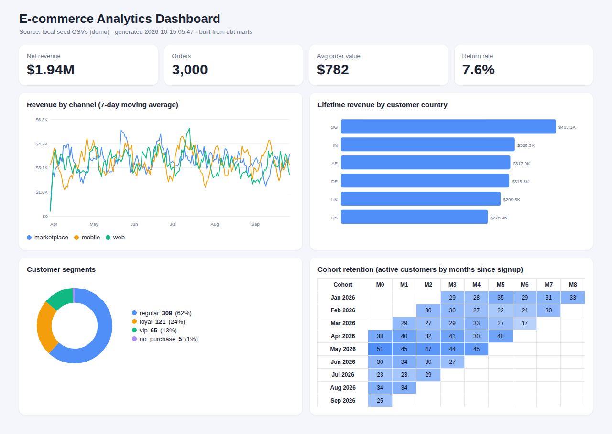

# E-commerce Analytics Platform: dbt + BigQuery

End-to-end analytics engineering project: raw data -> tested dbt models -> BigQuery marts -> Looker Studio dashboard.

## Architecture
```
seeds (raw CSV) -> staging views (clean/cast) -> marts:
   fct_orders (incremental) | dim_customers | fct_daily_revenue | mart_monthly_cohorts  -> Looker Studio
```
In production, swap `ref('raw_*')` for `source()` pointing at real ingestion tables.

## Highlights
- Incremental, date-partitioned and clustered fact table (`insert_overwrite`) to cut BigQuery scan cost
- Business metrics: recognised revenue (completed orders only), AOV, return rate, 7-day moving average, customer segments, cohort retention
- 20+ data tests (unique, not_null, relationships, accepted_values, dbt_utils ranges) plus a custom reconciliation test
- GitHub Actions CI runs `dbt build` on every pull request

## Run it (full step-by-step guide with expected output: see SETUP.md)
```bash
pip install dbt-bigquery
gcloud auth application-default login
cp profiles.yml.example ~/.dbt/profiles.yml   # set your GCP project id
dbt deps
dbt seed          # loads the sample CSVs (regenerate with: python scripts/generate_seed_data.py)
dbt build         # run + test everything
dbt docs generate && dbt docs serve
```

## Dashboard (auto-generated)
`python run_all.py` builds the models, then generates `dashboard/dashboard.html` (KPIs, channel trend, country revenue, segments, cohort heatmap) and opens it.


## Optional: Looker Studio
1. Add BigQuery data sources: `fct_daily_revenue`, `dim_customers`, `mart_monthly_cohorts`.
2. Pages: **Executive** (revenue / AOV / return-rate scorecards, revenue by channel time series),
   **Customers** (segment breakdown, revenue by country, top VIP table),
   **Retention** (cohort pivot table with heatmap colouring).
3. Screenshot each page for your portfolio.

## Resume bullets
- Built a dbt + BigQuery analytics warehouse (staging -> marts) with incremental, partitioned and clustered fact tables to reduce query cost.
- Implemented 20+ automated data-quality tests and a reconciliation check; integrated `dbt build` into GitHub Actions CI.
- Defined business metrics (AOV, return rate, cohort retention, customer segmentation) and delivered Looker Studio dashboards.
